# Detailed database ERD

Generated from actual SQLAlchemy model metadata. Mermaid supports zoom/rendering in compatible Markdown viewers. Each relationship is derived from a foreign key; unique FKs are one-to-one at most.

```mermaid
erDiagram
    addresses {
        integer id PK
        integer user_id FK
        string label
        string street
        string city
        string zip_code
    }
    allergens {
        integer id PK
        string name UK
    }
    attendance_records {
        integer id PK
        integer staff_id FK
        datetime clock_in
        datetime clock_out
    }
    audit_logs {
        integer id PK
        integer actor_id FK
        string action
        string entity
        integer entity_id
        datetime created_at
    }
    cart_item_modifiers {
        integer id PK
        integer cart_item_id FK
        integer option_id FK
    }
    cart_items {
        integer id PK
        integer cart_id FK
        integer item_id FK
        integer quantity
        string note
    }
    carts {
        integer id PK
        integer user_id FK
        string session_key
        datetime created_at
    }
    cash_sessions {
        integer id PK
        integer cashier_id FK
        datetime opened_at
        datetime closed_at
        numeric opening_balance
        numeric closing_balance
    }
    categories {
        integer id PK
        string name UK
        string slug UK
        integer sort_order
    }
    combo_items {
        integer id PK
        integer combo_id FK
        integer item_id FK
        integer quantity
    }
    combos {
        integer id PK
        string name
        float price
    }
    contact_messages {
        integer id PK
        string name
        string email
        text message
        integer user_id FK
        integer assigned_to FK
        string department
        boolean is_resolved
        datetime created_at
    }
    coupon_usages {
        integer id PK
        integer coupon_id FK
        integer user_id FK
        integer order_id FK
        datetime created_at
    }
    coupons {
        integer id PK
        string code UK
        integer percent_off
        float min_subtotal
        date expires_on
        boolean is_active
    }
    deliveries {
        integer id PK
        integer order_id FK,UK
        integer zone_id FK
        integer driver_id FK
        string street
        string zip_code
    }
    delivery_drivers {
        integer id PK
        string name
        string phone
    }
    delivery_zones {
        integer id PK
        string name
        string zip_code UK
        float fee
    }
    dining_tables {
        integer id PK
        integer store_id FK
        string label
        integer seats
    }
    expenses {
        integer id PK
        integer recorded_by FK
        string category
        string description
        numeric amount
        datetime created_at
    }
    favorites {
        integer id PK
        integer user_id FK
        integer item_id FK
    }
    holidays {
        integer id PK
        integer store_id FK
        date on_date
        string reason
    }
    ingredients {
        integer id PK
        string name UK
        integer supplier_id FK
        string unit
        numeric reorder_level
    }
    item_allergens {
        integer id PK
        integer item_id FK
        integer allergen_id FK
    }
    item_images {
        integer id PK
        integer item_id FK
        string url
        string alt_text
    }
    item_ingredients {
        integer id PK
        integer item_id FK
        integer ingredient_id FK
        numeric quantity
    }
    item_modifier_groups {
        integer id PK
        integer item_id FK
        integer group_id FK
    }
    item_tags {
        integer id PK
        integer item_id FK
        integer tag_id FK
    }
    loyalty_accounts {
        integer id PK
        integer user_id FK,UK
        integer points
    }
    loyalty_transactions {
        integer id PK
        integer account_id FK
        integer order_id FK
        integer points
        string reason
        datetime created_at
    }
    menu_items {
        integer id PK
        integer category_id FK
        string name
        text description
        float price
        boolean is_available
        boolean is_spicy
        boolean is_vegetarian
    }
    modifier_groups {
        integer id PK
        string name
        boolean is_required
        boolean allow_multiple
    }
    modifier_options {
        integer id PK
        integer group_id FK
        string name
        float extra_price
    }
    notifications {
        integer id PK
        integer user_id FK
        string message
        boolean is_read
        datetime created_at
    }
    nutrition_info {
        integer id PK
        integer item_id FK,UK
        integer calories
        float protein_g
        float carbs_g
        float fat_g
    }
    opening_hours {
        integer id PK
        integer store_id FK
        integer weekday
        string opens
        string closes
    }
    order_item_modifiers {
        integer id PK
        integer order_item_id FK
        string name
        float extra_price
    }
    order_items {
        integer id PK
        integer order_id FK
        integer item_id FK
        string name
        float unit_price
        integer quantity
    }
    order_status_history {
        integer id PK
        integer order_id FK
        string status
        integer actor_id FK
        datetime created_at
    }
    orders {
        integer id PK
        integer user_id FK
        integer coupon_id FK
        integer table_id FK
        integer waiter_id FK
        string order_type
        string status
        string customer_name
        string customer_phone
        float subtotal
        float discount
        float delivery_fee
        float total
        datetime created_at
    }
    payment_methods {
        integer id PK
        string name UK
        boolean is_active
    }
    payments {
        integer id PK
        integer order_id FK
        integer method_id FK
        float amount
        string status
        integer received_by FK
        datetime created_at
    }
    permissions {
        integer id PK
        string code UK
    }
    promotion_items {
        integer id PK
        integer promotion_id FK
        integer item_id FK
        float promo_price
    }
    promotions {
        integer id PK
        string title
        text description
        date starts_on
        date ends_on
    }
    purchase_order_items {
        integer id PK
        integer purchase_id FK
        integer ingredient_id FK
        numeric quantity
        numeric unit_cost
    }
    purchase_orders {
        integer id PK
        integer supplier_id FK
        integer requested_by FK
        string status
        datetime created_at
    }
    reservations {
        integer id PK
        integer table_id FK
        integer user_id FK
        string guest_name
        string guest_phone
        integer party_size
        datetime reserved_for
        datetime ends_at
        string status
        datetime created_at
    }
    review_replies {
        integer id PK
        integer review_id FK
        integer user_id FK
        text body
        datetime created_at
    }
    reviews {
        integer id PK
        integer user_id FK
        integer item_id FK
        integer rating
        text comment
        datetime created_at
    }
    role_permissions {
        integer id PK
        integer role_id FK
        integer permission_id FK
    }
    roles {
        integer id PK
        string name UK
    }
    service_requests {
        integer id PK
        integer customer_id FK
        integer order_id FK
        integer assigned_to FK
        string body
        string status
        datetime created_at
    }
    staff_leaves {
        integer id PK
        integer staff_id FK
        string leave_type
        date start_date
        date end_date
        text reason
        string status
        datetime created_at
    }
    staff_members {
        integer id PK
        integer user_id FK,UK
        string name
        string role
        string phone
        string email
        float salary_monthly
        integer manager_id FK
        string shift_status
        float shift_hours_done
        float shift_hours_total
        string avatar_url
        date joined_date
        datetime created_at
    }
    staff_messages {
        integer id PK
        integer staff_id FK
        integer sender_id FK
        string subject
        text body
        text reply
        datetime replied_at
        datetime created_at
    }
    staff_payrolls {
        integer id PK
        integer staff_id FK
        string month
        integer year
        float base_salary
        float bonus
        float deductions
        float net_salary
        string payment_status
        datetime created_at
    }
    staff_shifts {
        integer id PK
        integer staff_id FK
        datetime starts_at
        datetime ends_at
    }
    stock_batches {
        integer id PK
        integer ingredient_id FK
        integer supplier_id FK
        numeric remaining
        numeric unit_cost
        date expires_on
        datetime created_at
    }
    stock_movements {
        integer id PK
        integer batch_id FK
        integer order_id FK
        integer actor_id FK
        numeric quantity
        string reason
        datetime created_at
    }
    store_info {
        integer id PK
        string name
        string street
        string city
        string zip_code
        string phone
    }
    suppliers {
        integer id PK
        string name
        string phone
    }
    tags {
        integer id PK
        string name UK
    }
    users {
        integer id PK
        integer role_id FK
        string name
        string email UK
        string phone
        boolean is_active
        string password_hash
        datetime created_at
    }
    users ||--o{ addresses : user_id
    staff_members ||--o{ attendance_records : staff_id
    users ||--o{ audit_logs : actor_id
    cart_items ||--o{ cart_item_modifiers : cart_item_id
    modifier_options ||--o{ cart_item_modifiers : option_id
    carts ||--o{ cart_items : cart_id
    menu_items ||--o{ cart_items : item_id
    users |o--o{ carts : user_id
    users ||--o{ cash_sessions : cashier_id
    combos ||--o{ combo_items : combo_id
    menu_items ||--o{ combo_items : item_id
    users |o--o{ contact_messages : assigned_to
    users |o--o{ contact_messages : user_id
    coupons ||--o{ coupon_usages : coupon_id
    orders |o--o{ coupon_usages : order_id
    users |o--o{ coupon_usages : user_id
    delivery_drivers |o--o{ deliveries : driver_id
    orders ||--o| deliveries : order_id
    delivery_zones |o--o{ deliveries : zone_id
    store_info ||--o{ dining_tables : store_id
    users ||--o{ expenses : recorded_by
    menu_items ||--o{ favorites : item_id
    users ||--o{ favorites : user_id
    store_info ||--o{ holidays : store_id
    suppliers |o--o{ ingredients : supplier_id
    allergens ||--o{ item_allergens : allergen_id
    menu_items ||--o{ item_allergens : item_id
    menu_items ||--o{ item_images : item_id
    ingredients ||--o{ item_ingredients : ingredient_id
    menu_items ||--o{ item_ingredients : item_id
    modifier_groups ||--o{ item_modifier_groups : group_id
    menu_items ||--o{ item_modifier_groups : item_id
    menu_items ||--o{ item_tags : item_id
    tags ||--o{ item_tags : tag_id
    users ||--o| loyalty_accounts : user_id
    loyalty_accounts ||--o{ loyalty_transactions : account_id
    orders |o--o{ loyalty_transactions : order_id
    categories ||--o{ menu_items : category_id
    modifier_groups ||--o{ modifier_options : group_id
    users ||--o{ notifications : user_id
    menu_items ||--o| nutrition_info : item_id
    store_info ||--o{ opening_hours : store_id
    order_items ||--o{ order_item_modifiers : order_item_id
    menu_items |o--o{ order_items : item_id
    orders ||--o{ order_items : order_id
    users |o--o{ order_status_history : actor_id
    orders ||--o{ order_status_history : order_id
    coupons |o--o{ orders : coupon_id
    dining_tables |o--o{ orders : table_id
    users |o--o{ orders : user_id
    users |o--o{ orders : waiter_id
    payment_methods ||--o{ payments : method_id
    orders ||--o{ payments : order_id
    users |o--o{ payments : received_by
    menu_items ||--o{ promotion_items : item_id
    promotions ||--o{ promotion_items : promotion_id
    ingredients ||--o{ purchase_order_items : ingredient_id
    purchase_orders ||--o{ purchase_order_items : purchase_id
    users ||--o{ purchase_orders : requested_by
    suppliers ||--o{ purchase_orders : supplier_id
    dining_tables ||--o{ reservations : table_id
    users |o--o{ reservations : user_id
    reviews ||--o{ review_replies : review_id
    users ||--o{ review_replies : user_id
    menu_items ||--o{ reviews : item_id
    users ||--o{ reviews : user_id
    permissions ||--o{ role_permissions : permission_id
    roles ||--o{ role_permissions : role_id
    users |o--o{ service_requests : assigned_to
    users ||--o{ service_requests : customer_id
    orders |o--o{ service_requests : order_id
    staff_members ||--o{ staff_leaves : staff_id
    staff_members |o--o{ staff_members : manager_id
    users |o--o| staff_members : user_id
    users ||--o{ staff_messages : sender_id
    staff_members ||--o{ staff_messages : staff_id
    staff_members ||--o{ staff_payrolls : staff_id
    staff_members ||--o{ staff_shifts : staff_id
    ingredients ||--o{ stock_batches : ingredient_id
    suppliers |o--o{ stock_batches : supplier_id
    users ||--o{ stock_movements : actor_id
    stock_batches ||--o{ stock_movements : batch_id
    orders |o--o{ stock_movements : order_id
    roles ||--o{ users : role_id
```

